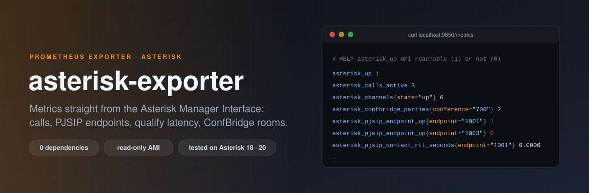

<p align="center">
  
</p>

<p align="center">
  <a href="https://github.com/ErenOzgu/asterisk-exporter/actions/workflows/ci.yml"></a>
  
  
  
  <a href="LICENSE"></a>
</p>

A small Prometheus exporter for [Asterisk](https://www.asterisk.org/). On every scrape it opens one session to the Asterisk Manager Interface (AMI), runs a few read-only actions and turns the answers into metrics: active calls and channels, PJSIP endpoint and contact state, qualify round-trip times, ConfBridge rooms, and optionally legacy `chan_sip` peers. It is a single static binary with **no third-party Go dependencies**.

It comes with a Grafana dashboard, alert rules with unit tests, and a one-command demo.

## Why this exists

Asterisk ships its own `res_prometheus` module. If you can use it, try it first: it needs no extra process. This exporter covers what it leaves out, and the cases where it is not an option:

| | `res_prometheus` (Asterisk 20.6) | asterisk-exporter |
|---|---|---|
| Channels, calls, endpoint states, uptime | yes | yes |
| ConfBridge rooms and participants | no | yes |
| PJSIP qualify round-trip time per endpoint | no | yes |
| `chan_sip` peers | no | yes |
| Needs Asterisk's HTTP server enabled | yes | no (AMI on localhost is enough) |
| Usable where the module is not available | no | yes (AMI only; `-collect.sip` for `chan_sip` systems) |

The two can run side by side: the metric names do not collide.

## Quick start

**1. Give the exporter an AMI user** ([`deploy/asterisk/manager.conf`](deploy/asterisk/manager.conf)):

```ini
[exporter]
secret = change-me
deny = 0.0.0.0/0.0.0.0
permit = 127.0.0.1/255.255.255.255
write = system,reporting   ; AMI authorises actions by the write class
read =                     ; the exporter logs in with Events: off
```

Then `asterisk -rx "manager reload"`. The exporter only sends status and list actions (`CoreStatus`, `CoreSettings`, `CoreShowChannels`, `PJSIPShowEndpoints`, `PJSIPShowContacts`, `ConfbridgeListRooms`, optionally `SIPpeers`), never anything that changes state.

**2. Run it** (binaries and a container image come with each [release](https://github.com/ErenOzgu/asterisk-exporter/releases)):

```bash
export ASTERISK_AMI_USERNAME=exporter ASTERISK_AMI_SECRET=change-me
./asterisk-exporter -asterisk.timezone UTC     # serves :9650/metrics
```

or

```bash
docker run --rm --network host \
  -e ASTERISK_AMI_USERNAME=exporter -e ASTERISK_AMI_SECRET=change-me \
  ghcr.io/erenozgu/asterisk-exporter:latest -asterisk.timezone UTC
```

A hardened systemd unit is in [`deploy/systemd/`](deploy/systemd/asterisk-exporter.service). To build from source: `go build ./cmd/asterisk-exporter`. If you would rather not do this by hand, the Ansible roles in [asterisk-gcp-iac](https://github.com/ErenOzgu/asterisk-gcp-iac) install a pinned release (checksum verified) together with its AMI user and unit.

**3. Scrape it:**

```yaml
scrape_configs:
  - job_name: asterisk
    static_configs:
      - targets: ["localhost:9650"]
```

Import [`deploy/grafana/dashboards/asterisk.json`](deploy/grafana/dashboards/asterisk.json) into Grafana and load [`deploy/prometheus/alerts.yml`](deploy/prometheus/alerts.yml) into Prometheus.

## Try it without an Asterisk

```bash
docker compose up -d --build
```

This starts a simulated Asterisk (calls come and go, endpoints drop off, a conference fills up), the exporter, Prometheus with the alert rules, and Grafana opening straight on the dashboard at <http://localhost:3000>. Everything binds to `127.0.0.1`; the demo Grafana allows anonymous admin access, so do not expose it as is.

## Flags

| Flag | Default | |
|---|---|---|
| `-ami.address` | `127.0.0.1:5038` | AMI host:port |
| `-ami.username` | env `ASTERISK_AMI_USERNAME` | AMI user |
| `-ami.secret-file` | env `ASTERISK_AMI_SECRET` | File with the AMI secret. There is deliberately no `-ami.secret` flag: it would show up in the process list |
| `-ami.timeout` | `5s` | Time budget for one whole scrape. Keep it below Prometheus' `scrape_timeout` |
| `-asterisk.timezone` | `Local` | Zone Asterisk reports its start time in (AMI prints local time without an offset) |
| `-collect.pjsip` | `true` | PJSIP endpoints and contacts |
| `-collect.confbridge` | `true` | ConfBridge rooms |
| `-collect.sip` | `false` | Legacy `chan_sip` peers |
| `-collect.per-endpoint` | `true` | Per-endpoint and per-peer series; turn off on very large systems |
| `-web.listen-address` | `:9650` | |
| `-web.telemetry-path` | `/metrics` | |

`/healthz` answers `ok` while the exporter process is alive; whether Asterisk is reachable is the `asterisk_up` metric.

## Metrics

| Metric | Labels | Meaning |
|---|---|---|
| `asterisk_up` | | 1 if the last scrape could log in to AMI |
| `asterisk_info` | `version`, `ami_version`, `system_name` | Always 1 |
| `asterisk_core_start_time_seconds` | | Start time (Unix). Uptime is `time() - …` |
| `asterisk_core_last_reload_time_seconds` | | Last reload (Unix) |
| `asterisk_core_current_channels` | | Every allocated channel, internal ones included |
| `asterisk_core_max_calls` | | Configured `maxcalls`, 0 = unlimited |
| `asterisk_channels` | `state` | Listed channels by state; all known states are always present |
| `asterisk_calls_active` | | Distinct calls (all legs of a call share one `Linkedid`) |
| `asterisk_pjsip_endpoints` | `state` | Endpoints by device state |
| `asterisk_pjsip_endpoint_up` | `endpoint` | 0 if unavailable or invalid |
| `asterisk_pjsip_endpoint_active_channels` | `endpoint` | |
| `asterisk_pjsip_contacts` | `status` | Registered contacts by qualify status |
| `asterisk_pjsip_contact_rtt_seconds` | `endpoint` | Qualify round trip of reachable contacts (slowest if several) |
| `asterisk_confbridge_rooms` | | Active conferences |
| `asterisk_confbridge_parties` | `conference` | Participants per conference |
| `asterisk_sip_peers`, `asterisk_sip_peer_up` | `status`, `peer` | With `-collect.sip` |
| `asterisk_collector_success` | `collector` | 1 if that collector worked in the last scrape |
| `asterisk_collector_duration_seconds` | `collector` | |
| `asterisk_scrape_duration_seconds` | | |
| `asterisk_exporter_build_info` | `version`, `goversion` | |

A scrape against a real Asterisk 20.6 with three calls and one conference looks like this (trimmed):

```text
asterisk_up 1
asterisk_calls_active 3
asterisk_channels{state="up"} 6
asterisk_core_current_channels 8
asterisk_confbridge_rooms 1
asterisk_confbridge_parties{conference="700"} 2
asterisk_pjsip_endpoint_up{endpoint="100"} 1
asterisk_pjsip_endpoint_up{endpoint="102"} 0
asterisk_pjsip_contacts{status="reachable"} 1
asterisk_pjsip_contact_rtt_seconds{endpoint="100"} 0.000368
```

Some queries to start from:

```promql
time() - asterisk_core_start_time_seconds                  # uptime
sum by (instance) (asterisk_calls_active)                  # calls right now
asterisk_pjsip_endpoint_up == 0                            # endpoints that are down
topk(5, asterisk_pjsip_contact_rtt_seconds)                # worst links
```

[`deploy/prometheus/alerts.yml`](deploy/prometheus/alerts.yml) has nine rules (Asterisk or exporter down, collector failing, restarts, endpoints unavailable, half the fleet unavailable, high latency, near `maxcalls`, slow scrapes). They are unit-tested with `promtool test rules`.

## Things worth knowing

These came from running against a real Asterisk, not from the documentation:

- **`CoreCurrentCalls` is a channel count.** AMI's `CoreStatus` field of that name returned 6 on a PBX that had 2 calls. The exporter exports it as `asterisk_core_current_channels` and derives `asterisk_calls_active` from `CoreShowChannels` instead.
- **Start time has no time zone.** AMI prints `CoreStartupDate`/`CoreStartupTime` in the PBX's local time. If the exporter runs in another zone, uptime is off by the difference, hence `-asterisk.timezone`.
- **Empty lists can be errors.** `PJSIPShowContacts` answers `No Contacts found` and `ConfbridgeListRooms` answers `No active conferences.` as `Response: Error`. The exporter treats these as empty lists.
- **Static contacts are not listed.** Contacts defined with `contact=` in an AOR show up in `pjsip show contacts` but not in the `PJSIPShowContacts` action, so `asterisk_pjsip_contacts` counts registered contacts. The endpoint state still reflects static ones.
- **Permissions.** On 20.6 an action needs just one of its listed classes (`system` for PJSIP, `reporting` for ConfBridge). A missing class is reported in the log and as `asterisk_collector_success 0`, with the class that is needed.

## How it works

- One AMI session per scrape: connect, log in with `Events: off`, run the actions, log off. There is no connection state that can go stale, and scrapes are serialised so several Prometheus servers cannot pile up sessions on Asterisk.
- One time budget (`-ami.timeout`) covers the whole scrape. A hung Asterisk costs one timeout, not a stuck exporter.
- A collector that fails does not take the others down, and it leaves no half-filled metric families behind: its series are dropped and `asterisk_collector_success{collector=…}` goes to 0. Failures are logged once per distinct message, not on every scrape.
- The Prometheus text format is written by a small built-in package (`internal/expfmt`) instead of a client library, which is what keeps the dependency count at zero. Output is sorted, so it is stable and diffable; it passes `promtool check metrics`.

## Testing

| What | How |
|---|---|
| AMI client, exposition format, collectors | Unit tests with `-race` on Go 1.21 and 1.23, including timeouts, truncated lists, permission errors, header injection, and a golden file of the full output |
| Against a **real Asterisk** | [`hack/integration-test.sh`](hack/integration-test.sh) configures a PBX (three PJSIP endpoints, one registered through a small SIP stub, a ConfBridge room), places calls with Local channels, scrapes and checks the numbers. CI runs it on the Asterisk packages of Ubuntu 22.04 (18.x) and 24.04 (20.x) |
| Prometheus side | `promtool check rules`, `promtool test rules`, `promtool check metrics`, and every dashboard query checked for valid PromQL |
| The demo | CI starts the compose stack and verifies simulator → exporter → Prometheus (rules healthy) → Grafana (datasource healthy, dashboard provisioned) |

The simulator in `internal/amisim` reproduces the packet layouts captured from that real Asterisk; it exists for fast tests and the demo, and the integration test is what keeps it honest.

## Limitations

- Linux or anything else Go builds for; AMI only, no ARI or HTTP.
- AMI is plain text on TCP: keep it on localhost or a private network. The exporter has no TLS option for AMI yet.
- Metrics that need `Command` (for example `core show uptime`) are avoided on purpose: that action requires the powerful `command` permission.

## License

MIT, see [LICENSE](LICENSE).
